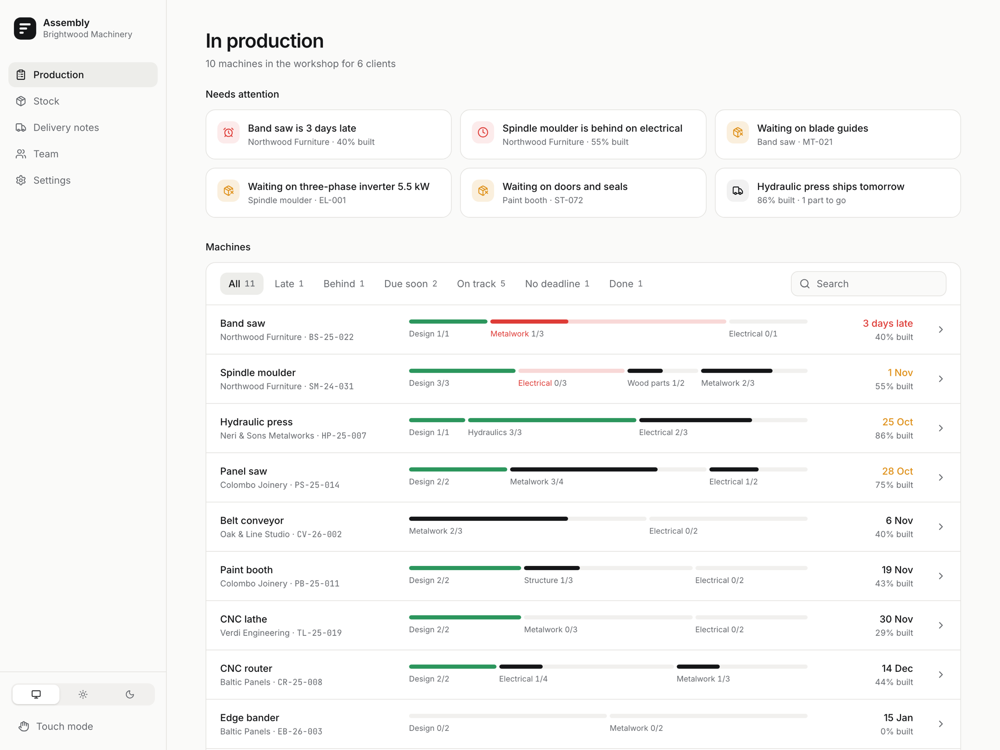
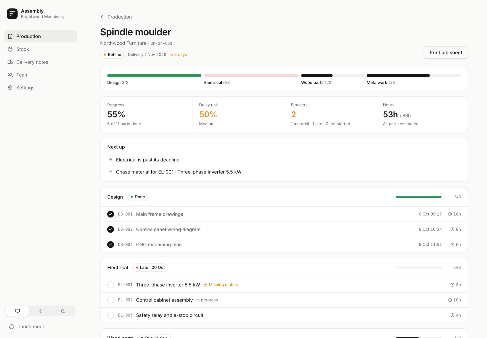
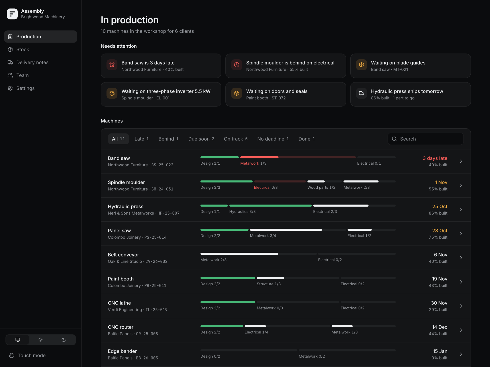
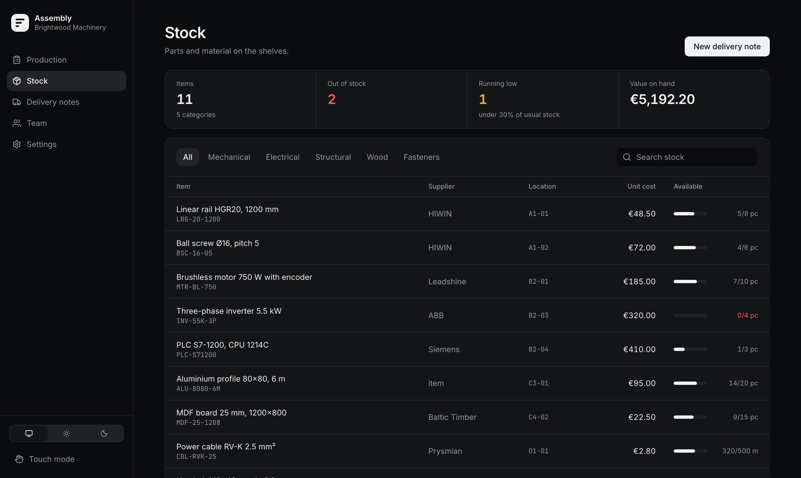

# Assembly

Production tracking for small workshops that build machines to order.



## Why it exists

I started this for a small family workshop that builds custom woodworking machines: band saws, panel saws, moulders. Each machine is a project of its own. It gets designed, wired, welded and assembled over a few weeks, by a handful of people, while parts are still being ordered.

They ran all of it on a whiteboard and a shared spreadsheet. Nobody could tell at a glance which machine was going to ship late, or that a whole phase was stuck waiting on one inverter. ERP systems could do it, but they're built for the office, cost a lot, and nobody wants to use them at the workbench.

Assembly is the small tool in between. Open it in the morning and you see:

- **What needs attention:** machines that are late, phases that slipped, parts still waiting on material, and what ships this week.
- **Where every machine is:** each one as a row of phases (design, electrical, metalwork…) that fill up as parts get finished.
- **What to do next** on a given machine, most urgent first.

## How it works

A machine order is split into **phases**, and each phase into **parts**: the actual jobs someone does at the bench. People tick parts off as they finish them, and everything else is derived from that: progress, late phases, blockers, delay risk, hours done.



A few things came straight from how a workshop runs:

- **Work gets logged after the fact.** Ticking a part asks when it was finished: just now, earlier today, or another day.
- **Missing material blocks a part.** It can still be completed, but it's marked as forced, so nobody is fooled later.
- **Touch mode** makes everything bigger, for a tablet mounted on the shop floor.
- **Delivery notes** are built from the stock list and print cleanly.

| | |
|---|---|
|  |  |

## Under the hood

- React 19, TypeScript, Vite, Tailwind CSS v4, Recharts.
- No backend yet. State lives in `localStorage` behind a tiny store built on `useSyncExternalStore` (`src/lib/store.ts`), so swapping it for an API later only touches one place.
- Every number on screen comes from pure functions in `src/lib/metrics.ts`, covered by unit tests.
- The demo data (`src/data/seed.ts`) is a fictional workshop, with dates relative to today so it never looks stale.
- Light and dark themes come from a handful of CSS tokens; colour is reserved for status.

## Run it

```bash
npm install
npm run dev
```

```bash
npm test        # metrics unit tests
npm run build   # type-check and production build
```

Settings → Demo data → Reset brings back the sample workshop.

## What's next

- A real backend with accounts, so the office and the floor share the same data.
- Start dates for phases, to draw an actual schedule instead of deadlines only.
- Linking stock to parts, so a delivery of material unblocks parts on its own.
